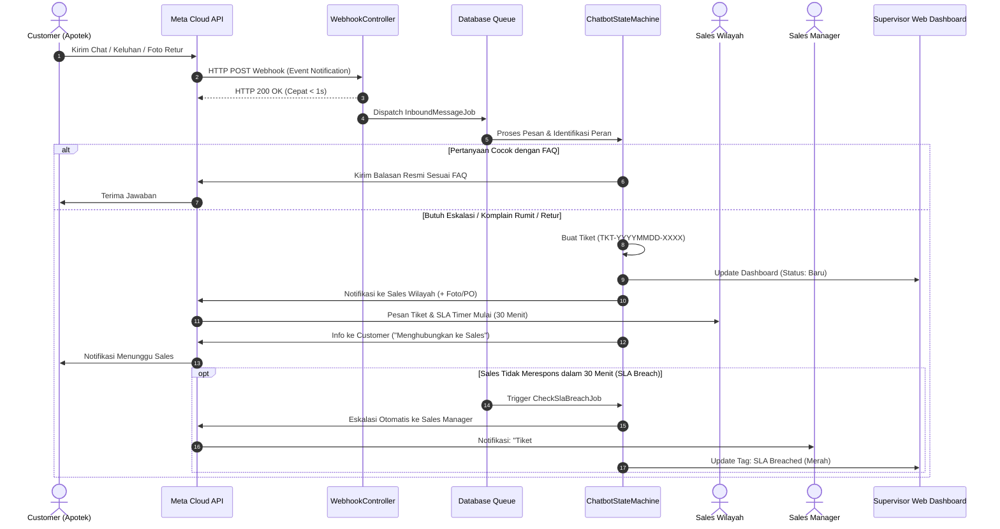

# IMPLEMENTATION PLAN — CHATBOT WA APOTEK & CRM DASHBOARD
**Proyek Tugas Akhir: Natasia Utama (31123024) — Teknik Informatika Universitas Widya Kartika**  
**Referensi Model Desain:** Omnichannel CRM & WhatsApp Bot Architecture (Mekari Qontak Benchmark)  
**Versi:** 1.0 (Menunggu Persetujuan)

---

## 1. Keputusan Stack Teknologi

Berdasarkan lingkungan kerja lokal Anda (Windows Laragon) dan spesifikasi PRD, stack yang diputuskan adalah:

| Komponen | Pilihan Teknologi | Alasan & Trade-off |
| :--- | :--- | :--- |
| **Backend Framework** | **Laravel 11** | Standar enterprise PHP, ekosistem queue bawaan sangat matang, migration DB terstruktur, dan mudah diuji (PHPUnit / Pest). |
| **Bahasa Pemrograman** | **PHP 8.4.10** | Versi aktif di Laragon Anda, performa tinggi, fitur typing kuat. |
| **Basis Data** | **MySQL 8.4.3 (Laragon)** | Port 3306, user `root`, database: `db_ta_natashia`. Sangat mudah dimonitor via **Navicat**. |
| **Queue & Worker** | **Database Queue Driver** | Webhook WhatsApp dari Meta **wajib** membalas HTTP 200 dalam < 1 detik. Pemrosesan pesan dan pengunduhan foto retur wajib masuk queue agar tidak timeout. |
| **Integrasi Pesan** | **Meta WhatsApp Business Cloud API** | API resmi dari Meta. Menggunakan Sandbox / Test Number untuk development dan siap beralih ke nomor baru tanpa ubah kode. |
| **Semantic Matching (AI)** | **Hybrid Matcher (Levenshtein + Trigram + GenAI Intent)** | Teks apotek dicocokkan ke 5 FAQ kanonik. GenAI digunakan untuk memahami bahasa slang/singkat apotek, namun balasan tetap deterministik dari tabel FAQ (anti-halusinasi). |
| **Web Dashboard** | **Laravel Blade + Tailwind CSS** | Mengadopsi UI modern bergaya **Mekari Qontak** untuk monitoring tiket komplain, foto retur, pemantauan SLA sales, dan manajemen FAQ. |
| **Penyimpanan Berkas** | **Local Private Storage (`storage/app/private/returns/`)** | Foto retur diunduh dari Graph API Meta dan disimpan dengan nama acak (UUID). File dilindungi dari akses publik liar. |
| **Sinkronisasi Eksternal** | **Google Sheets API v4 (Google Drive Natasia)** | Sebagai data master non-teknis (backup data) untuk staf apotek/sales manager. |

---

## 2. Arsitektur Alur Sistem (Mermaid Diagram)

### 2.1 Alur Pesan & Eskalasi (Model Mekari Qontak)



---

## 3. Skema Basis Data Final (`db_ta_natashia`)

Berikut struktur tabel yang akan dibuat via Laravel Migration dan dapat langsung Anda inspeksi di **Navicat**:

```
1. users
   - id, name, wa_number (UNIQUE), role ENUM('admin','manager','sales'), is_active, created_at, updated_at
2. customers
   - id, kode_apotek (UNIQUE), nama_apotek, wa_number (UNIQUE), alamat, default_sales_id, verified_at, created_at
3. customer_sales (relasi fleksibel apotek-sales)
   - id, customer_id, sales_id, wilayah
4. conversations
   - id, customer_id, current_state ENUM('IDLE','MENU','FAQ_CONFIRM','RETURN_FORM','PO_SUBMIT','IN_HANDOFF'), active_ticket_id, last_inbound_at
5. messages
   - id, wa_message_id (UNIQUE/Idempoten), conversation_id, sender_role, direction ENUM('inbound','outbound'), message_type, body, raw_payload, created_at
6. faqs
   - id, kategori, canonical_question, answer, is_active, created_at
7. faq_variants (variasi pertanyaan untuk pengujian & akurasi)
   - id, faq_id, variant_text
8. products
   - id, kode_produk (UNIQUE), nama_produk, satuan, is_active
9. stock_snapshots
   - id, product_id, status ENUM('Tersedia','Terbatas','Habis'), source_updated_at, notes
10. price_lists
    - id, product_id, harga, berlaku_dari, berlaku_sampai
11. tickets
    - id, ticket_code (UNIQUE: RTR-..., ESC-..., PO-...), type ENUM('retur','eskalasi','po'), customer_id, assigned_sales_id, status ENUM('baru','diproses','eskalasi_manager','selesai','ditolak'), sla_due_at, escalated_at, closed_at, created_at
12. return_requests
    - id, ticket_id, product_id, batch_number, qty, alasan, no_faktur
13. media_files
    - id, ticket_id, wa_media_id, local_path, file_name, mime_type, file_size, sha256_hash, created_at
14. bot_events (DATA EMAS BAB 4 PENGUJIAN SIDANG)
    - id, conversation_id, raw_query, intent_detected, confidence_score, matched_faq_id, outcome, response_time_ms, created_at
15. sync_logs
    - id, source ENUM('google_sheets','navicat_seed','web_ui'), status, total_records, notes, created_at
```

---

## 4. Matriks Keterlacakan (Traceability Matrix: FR $\rightarrow$ Modul $\rightarrow$ Test)

Setiap kebutuhan fungsional dijamin memiliki kelas servis dan bukti uji otomatis untuk sidang TA:

| ID | Kebutuhan Fungsional | Komponen Modul Laravel | Metode Pengujian (Unit & Feature Test) |
| :--- | :--- | :--- | :--- |
| **FR-01** | Identifikasi peran pengguna dari nomor WA | `App\Services\Auth\RoleResolverService` | `Tests\Feature\RoleResolverTest::test_identifies_apotek_and_sales` |
| **FR-02** | Menu interaktif utama Customer (List/Button) | `App\Services\Chat\MenuBuilderService` | `Tests\Unit\MenuPayloadTest::test_generates_valid_meta_interactive_json` |
| **FR-03** | Menjawab 5 FAQ terstandar tanpa halusinasi | `App\Services\Ai\SemanticFaqMatcher` | `Tests\Feature\FaqMatcherAccuracyTest::test_100_labeled_queries_accuracy` |
| **FR-04** | Cek update stok snapshot dan price list | `App\Services\Catalog\ProductCatalogService` | `Tests\Feature\StockPriceQueryTest::test_returns_timestamp_and_disclaimer` |
| **FR-05** | Form retur terstruktur + unduh foto aman | `App\Services\Return\ReturnTicketService` & `MediaDownloadService` | `Tests\Feature\ReturnFlowWithMediaTest::test_downloads_and_hashes_photo` |
| **FR-06** | Menerima PO (teks/foto/PDF) tanpa transaksi | `App\Services\Order\PoReceiverService` | `Tests\Feature\PoReceiverTest::test_creates_po_ticket_without_payment` |
| **FR-07** | Eskalasi berjenjang & SLA 30 menit ke Manager | `App\Services\Ticket\EscalationManager` & `CheckSlaBreachJob` | `Tests\Feature\SlaBreachEscalationTest::test_escalates_to_manager_after_30m` |
| **FR-08** | Supervisor Web Dashboard (gaya Mekari Qontak) | `App\Http\Controllers\Dashboard\TicketDashboardController` | `Tests\Feature\DashboardAccessTest::test_manager_views_all_sales_views_own` |
| **FR-09** | Log audit terstruktur & metrik evaluasi | `App\Services\Analytics\BotEventLogger` | `Tests\Unit\AuditLoggerTest::test_logs_intent_score_and_response_time` |

---

## 5. Rencana Fase Pengerjaan & Estimasi

```text
Fase 1: Setup Proyek & Database (Hari 1)
  - Inisialisasi Laravel 11 di folder C:\laragon\www\TA-Natashia
  - Konfigurasi .env (MySQL 8.4 Laragon, database: db_ta_natashia)
  - Migrasi seluruh 15 tabel skema database
  - Verifikasi tabel di Navicat

Fase 2: WhatsApp Webhook & Handler Idempoten (Hari 2)
  - Verifikasi signature Meta X-Hub-Signature-256
  - Controller webhook + database queueing
  - Penanganan pesan ganda (wa_message_id unique)

Fase 3: Core AI Chatbot & 5 FAQ Engine (Hari 3)
  - Integrasi 5 FAQ resmi dari PROJEK.docx
  - Normalisasi bahasa slang farmasi & pencocokan semantik
  - State machine percakapan & batas anti-halusinasi

Fase 4: Alur Retur Foto, Cek Stok/Harga & PO (Hari 4)
  - Download & enkapsulasi media foto retur dari Meta Graph API
  - Pembuatan tiket RTR-YYYYMMDD-XXXX
  - Fitur cek stok snapshot + disclaimer update

Fase 5: Mekanisme Eskalasi, SLA 30 Menit & Web Dashboard Mekari Qontak (Hari 5)
  - Notifikasi forward WA ke Sales & Sales Manager
  - Background scheduler SLA 30 menit
  - Web UI Dashboard di Laragon (Overview, Tiket, Galeri Foto Retur, Tombol Sync Sheets)

Fase 6: Pengujian Lengkap & Berkas Bukti Sidang (Hari 6)
  - Eksekusi 100 set uji pertanyaan FAQ berlabel
  - Penghitungan Precision, Recall, dan Waktu Respons (p95)
  - Pembuatan docs\REVIEW_PENGUJI.md untuk persiapan sidang
```

---

## 6. Analisis Risiko & Mitigasi

1. **Jendela 24 Jam Meta API:** Pesan yang diprakarsai bot ke sales/manager di luar 24 jam membutuhkan Meta Message Template.  
   *Mitigasi:* Sales dan Manager diwajibkan menyapa bot terlebih dahulu di awal shift (misal ketik `/mulai`), atau menggunakan template notifikasi resmi.
2. **Koneksi Internet Putus saat Unduh Foto Retur:**  
   *Mitigasi:* Menggunakan queue retry otomatis hingga 3x dengan backoff interval.
3. **Data Stok/Harga Kadaluwarsa:**  
   *Mitigasi:* Setiap info stok selalu menyertakan string peringatan: *"Data per [Tanggal/Jam], ketersediaan dapat berubah sewaktu-waktu"*.
